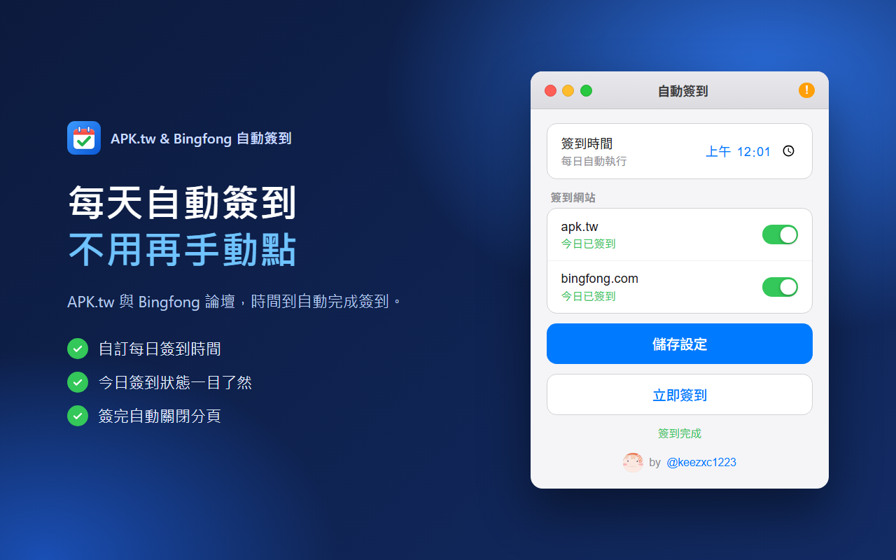
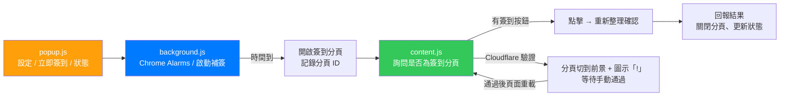

# APK.tw & Bingfong Auto Check-in

<p align="center">
  
</p>

<p align="center">
  輕量化 Chrome 擴充功能 — 每日自動簽到 <a href="https://apk.tw">APK.tw</a> 與 <a href="https://bingfong.com">Bingfong.com</a>
</p>

<p align="center">
  
  
  
  
</p>

## Screenshot

<p align="center">
  
</p>

## Features

- 每日自動在指定時間簽到 [APK.tw](https://apk.tw) 與 [Bingfong.com](https://bingfong.com)
- 自訂簽到時間（預設 00:01）
- 可分別開啟 / 關閉各網站的簽到功能
- 支援瀏覽器背景執行，關閉視窗後仍可自動簽到（最小化視窗自動建立）
- 智慧視窗管理：有視窗時開背景分頁，無視窗時自動建立最小化視窗
- 簽到後重新整理確認結果，完成後自動關閉分頁
- 漏簽補簽：排程時間瀏覽器沒開，下次啟動時自動補簽
- 遇到 Cloudflare 驗證時，分頁切到前景並在圖示顯示「!」；手動通過驗證後自動接續簽到（不會自動代為通過驗證）
- Popup 顯示各網站今日狀態，並提供「立即簽到」按鈕
- 只有擴充功能自己開的分頁會自動簽到，手動瀏覽不受影響

## Tech Stack

| 項目 | 技術 |
|------|------|
| 平台 | Chrome Extension (Manifest V3) |
| 排程 | Chrome Alarms API |
| 儲存 | Chrome Storage API（sync：設定／local：簽到狀態／session：簽到分頁追蹤） |
| 背景執行 | Service Worker + `background` 權限 |
| 內容注入 | Content Scripts (`document_idle`) |
| 簽到偵測 | DOM 元素點擊 + 以分頁 ID 辨識簽到分頁 |

## Architecture

```
checkin-extension/
├── manifest.json       # 擴充功能設定（Manifest V3）
├── background.js       # Service Worker — 排程管理 + 視窗管理
├── content.js          # Content Script — 頁面簽到邏輯
├── popup.html          # 設定介面 UI（macOS 風格）
├── popup.js            # 設定介面邏輯 + GitHub 頭像載入
├── icons/              # 擴充功能圖示 (16/48/128px)
└── screenshots/        # Chrome Web Store 截圖
```

### 運作流程



## Installation

### 方法一：開發者模式安裝

1. 下載或 Clone 此專案
   ```bash
   git clone https://github.com/keezxc1223/APK.tw-Bingfong-Auto-check-in.git
   ```
2. 開啟 Chrome，前往 `chrome://extensions/`
3. 右上角開啟 **開發人員模式**
4. 點擊 **載入未封裝項目**，選擇專案資料夾

### 方法二：Chrome Web Store（推薦）

<a href="https://chromewebstore.google.com/detail/nnomgpkeapbcalknabjhkalcdfolednn">
  
</a>

## Usage

1. 點擊工具列的擴充功能圖示
2. 設定每日簽到時間
3. 勾選想要自動簽到的網站（APK.tw / Bingfong）
4. 按下 **儲存設定** 即完成

## Configuration

| 設定項目 | 預設值 | 說明 |
|----------|--------|------|
| 簽到時間 | `00:01` | 每日自動簽到的時間（24 小時制） |
| APK.tw | 開啟 | 是否自動簽到 APK.tw |
| Bingfong | 開啟 | 是否自動簽到 Bingfong.com |

## Permissions

| 權限 | 用途 |
|------|------|
| `alarms` | 排程每日簽到任務 |
| `storage` | 儲存使用者設定（簽到時間、開關） |
| `background` | 允許瀏覽器關閉後持續背景執行 |
| `host_permissions` | 存取 apk.tw / bingfong.com 進行簽到操作 |

## Changelog

### v1.8
- 改以分頁 ID 追蹤簽到分頁，取代 URL hash（頁面重新載入後仍可接續）
- 偵測 Cloudflare 驗證：分頁切到前景、圖示顯示「!」，手動通過後自動接續簽到
- 漏簽補簽：瀏覽器啟動時若已過排程時間且今日未簽到，自動補簽
- 簽到後確認結果並自動關閉分頁；3 分鐘無回應視為失敗
- Bingfong 改為整頁前往簽到連結並讀取結果訊息（按鈕簽到前後都存在，且彈窗內無法顯示 Cloudflare 驗證）
- APK.tw 以 `#ppered` 出現作為簽到成功／已簽到的依據
- Popup 新增各網站今日狀態與「立即簽到」按鈕
- 移除不需要的 `github.com` host 權限

### v1.6
- 移除 `MAIN` world 注入，改用預設 Content Script 執行環境
- Content Script 匹配範圍擴大至整站（`*://apk.tw/*`），不再限於 `forum.php`
- 透過 URL hash (`#auto-checkin`) 區分排程觸發與手動瀏覽
- 排程觸發時自動重整頁面，手動瀏覽僅顯示成功訊息
- 移除 `localStorage` 防重複機制，改由 hash 判斷
- 新增 `background` 權限，支援瀏覽器關閉後背景執行
- 智慧視窗管理：有視窗開背景分頁，無視窗建最小化視窗

### v1.3
- 初始版本
- 支援 APK.tw / Bingfong.com 自動簽到
- Content Script 使用 `MAIN` world 注入
- `localStorage` 防重複簽到

## Notes

- 需先在瀏覽器中登入 [APK.tw](https://apk.tw) / [Bingfong.com](https://bingfong.com) 帳號，擴充功能才能正常簽到
- 若希望瀏覽器關閉後仍可簽到，請至 Chrome 設定 → 進階 → 系統，開啟「**Google Chrome 關閉時繼續執行背景應用程式**」
- 遇到 Cloudflare 驗證時需手動打勾一次，通過後擴充功能會自動完成簽到
- 圖示出現「!」代表有網站需要處理（等待驗證／尚未登入／簽到失敗），點開 popup 可查看並前往

## License

MIT License
